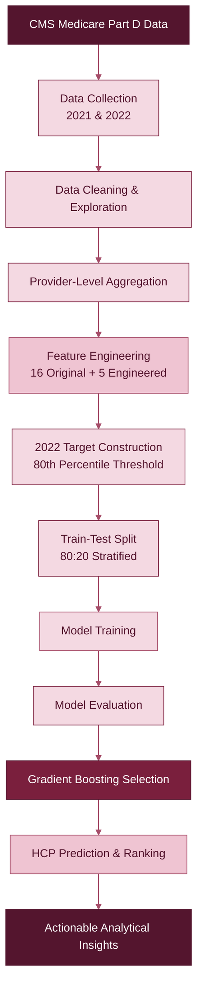

 <div align="center">

# 🩷 HCP TARGETING & PRESCRIPTION PREDICTION

### *Predicting Tomorrow's High-Value Healthcare Professionals Through Machine Learning*

<p>
  
  
  
  
</p>

**An end-to-end predictive analytics project using historical Medicare prescription patterns to identify healthcare professionals with the potential to become high Jardiance prescribers.**

[Project Overview](#-the-project) · [Methodology](#-how-it-works) · [Results](#-model-performance) · [Technology](#-technology-stack)

</div>

---

## 01 · THE PROJECT

<div align="center">

### *From Historical Prescriptions to Predictive Insights.*

</div>

Pharmaceutical analytics involves understanding how healthcare professionals prescribe medications and identifying patterns that may indicate future prescribing behaviour.

**HCP Targeting & Prescription Prediction** explores this challenge through machine learning.

Using publicly available **CMS Medicare Part D Prescriber Data**, this project analyzes prescription behaviour across four SGLT2 inhibitor drugs and predicts which healthcare professionals are likely to become high prescribers of **Jardiance (Empagliflozin)** in 2022.

Instead of relying only on historical Jardiance claims, the model also considers competitor prescription activity, drug costs, prescription shares and other engineered features.

<blockquote>
<strong>THE CENTRAL IDEA</strong><br/>
Can historical prescription behaviour help us identify healthcare professionals who are likely to become high Jardiance prescribers in the following year?
</blockquote>

## 02 · PROJECT AT A GLANCE

| | |
|:---|:---|
| **Domain** | Healthcare Analytics & Machine Learning |
| **Problem Type** | Binary Classification |
| **Data Source** | CMS Medicare Part D Prescriber Dataset |
| **Historical Period** | 2021 |
| **Prediction Period** | 2022 |
| **Target Drug** | Jardiance |
| **Competitor Drugs** | Farxiga, Invokana, Steglatro |
| **Provider Population** | 101,500 unique NPIs |
| **Final Features** | 21 |
| **Selected Algorithm** | Gradient Boosting Classifier |

## 03 · THE DATA STORY

### Understanding the prescription landscape

The project uses four drugs from the SGLT2 inhibitor category.

| Drug | Role in the Project | Generic Name |
|:---|:---|:---|
| **Jardiance** | 🎯 Target drug | Empagliflozin |
| Farxiga | Competitor | Dapagliflozin |
| Invokana | Competitor | Canagliflozin |
| Steglatro | Competitor | Ertugliflozin |

### Dataset statistics

<div align="center">

| 2021 DATA | 2022 DATA |
|:---:|:---:|
| **139,592** | **192,662** |
| Prescription records | Prescription records |
| **101,500** | **139,260** |
| Unique providers | Unique providers |

</div>

**Why NPI?**

The National Provider Identifier (NPI) serves as the unique healthcare provider identifier. It enables us to connect provider-level prescription information across different years.

**Data source:** [CMS Medicare Part D Prescribers ↗](https://data.cms.gov/provider-summary-by-type-of-service/medicare-part-d-prescribers)

## 04 · HOW IT WORKS

### The end-to-end machine learning pipeline



### The prediction strategy

| Stage | Approach |
|:---|:---|
| Input | 2021 prescribing behaviour |
| Feature preparation | Drug-level and provider-level metrics |
| Target construction | 2022 Jardiance prescription claims |
| Classification | High prescriber (1) / Not high prescriber (0) |
| Prediction | Probability of belonging to the high-prescriber class |
| Output | Provider-level predictions and ranked HCP list |

## 05 · FEATURE ENGINEERING

### Giving historical data more meaning

Five additional features were engineered to capture provider prescribing patterns and competitor activity.

| Engineered Feature | What It Captures |
|:---|:---|
| `total_sglt2_claims_2021` | Overall claims across the four selected drugs |
| `competitor_claims_2021` | Prescription activity for competitor drugs |
| `jardiance_claim_share_2021` | Jardiance's share of total selected drug claims |
| `num_competitor_drugs_2021` | Number of competitor drugs prescribed |
| `total_sglt2_drug_cost_2021` | Total drug cost across the selected drugs |

<div align="center">

| ORIGINAL FEATURES | ENGINEERED FEATURES | FINAL FEATURES |
|:---:|:---:|:---:|
| 16 | + 5 | **21** |

</div>

## 06 · TARGET VARIABLE

### Defining a high prescriber

The target variable was constructed using the distribution of 2022 Jardiance claims among the 2021 provider cohort.

The **80th percentile** was selected as the high-prescriber threshold.

<blockquote>
<strong>Classification threshold: 60 Jardiance claims</strong><br/>
Providers with 60 or more claims were labelled High Prescribers (1); providers below this threshold were labelled Not High Prescribers (0).
</blockquote>

### Target distribution

| Provider Class | Count | Distribution |
|:---|---:|---:|
| Not High Prescriber (0) | 80,870 | 79.67% |
| High Prescriber (1) | 20,630 | 20.33% |
| **Total** | **101,500** | **100%** |

## 07 · MODEL DEVELOPMENT

### Three algorithms. One predictive objective.

Three classification algorithms were trained and compared.

| Model | Purpose |
|:---|:---|
| Logistic Regression | Baseline linear classification |
| Random Forest | Ensemble learning with multiple decision trees |
| Gradient Boosting | Sequential boosting for improved predictive performance |

**Training configuration**

- Train-test ratio: 80:20
- Stratification: Enabled
- Random state: 42
- Training samples: 81,200
- Testing samples: 20,300
- Predictive features: 21

## 08 · MODEL PERFORMANCE

### Comparing the candidates

| Metric | Logistic Regression | Random Forest | Gradient Boosting |
|:---|---:|---:|---:|
| Accuracy | 90.00% | 88.82% | **90.05%** |
| Precision | **84.67%** | 76.66% | 82.03% |
| Recall | 62.00% | 64.71% | **65.37%** |
| F1-Score | 71.58% | 70.18% | **72.75%** |
| ROC-AUC | 92.01% | 90.10% | **92.13%** |
| PR-AUC | **81.97%** | 78.14% | 81.85% |

<div align="center">

### 🏆 SELECTED MODEL

# GRADIENT BOOSTING

**90.05% Accuracy · 92.13% ROC-AUC · 72.75% F1-Score**

</div>

Gradient Boosting was selected for its strongest overall balance across the evaluated metrics. Logistic Regression achieved slightly higher Precision and PR-AUC, so model selection was based on the combined evaluation rather than accuracy alone.

### Visual performance analysis

Add your exported model comparison graph here:

`assets/model_comparison.png`

Once the graph is uploaded, display it using:

``

## 09 · UNDERSTANDING THE MODEL

### Feature importance

The Gradient Boosting model's feature importance analysis identified historical Jardiance prescription activity as the strongest predictive signal.

Top contributing features included:

1. `Jardiance_Tot_Clms`
2. `Jardiance_Tot_30day_Fills`
3. `total_sglt2_claims_2021`

**Visual analysis:** Export your existing feature importance plot as `assets/feature_importance.png` and embed it below.

``

*Feature importance represents the model's learned predictive patterns. It does not establish causality or indicate the percentage of real-world prescribing behaviour explained.*

## 10 · PREDICTION & HCP PRIORITIZATION

### From classification to prioritization

The final model generates provider-level predictions using the probability of belonging to the high-prescriber class.

Each prediction contains:

| Output | Description |
|:---|:---|
| NPI | Unique provider identifier |
| `Predicted_Class` | Predicted high / not-high category |
| `High_Prescriber_Probability` | Estimated probability of the high-prescriber class |

Providers can be sorted by predicted probability to generate a ranked list for further analytical review.

**Final deliverables include:**

- Sample HCP predictions
- Probability-based ranked HCP predictions
- Saved Gradient Boosting model

## 11 · TECHNOLOGY STACK

<div align="center">

| CATEGORY | TECHNOLOGIES |
|:---|:---|
| Language | Python |
| Data Collection | CMS API, Requests |
| Data Manipulation | Pandas, NumPy |
| Visualization | Matplotlib, Seaborn |
| Machine Learning | Scikit-learn |
| Model Persistence | Joblib |
| Environment | Google Colab, Jupyter Notebook |
| Version Control | Git, GitHub |

</div>

## 12 · PROJECT STRUCTURE

```text
hcp-targeting-prediction/
│
├── README.md
│
├── notebooks/
│   └── HCP_Targeting_and_Prediction.ipynb
│
├── docs/
│   ├── Day_1_Data_Exploration.md
│   ├── Day_2_Data_Preprocessing.md
│   ├── Day_3_Target_Variable_Construction.md
│   ├── Day_4_Feature_Engineering.md
│   ├── Day_5_Model_Training_and_Evaluation.md
│   └── Day_6_Model_Finalization_and_Prediction.md
│
├── assets/
│   ├── project_banner.png
│   ├── target_distribution.png
│   ├── model_comparison.png
│   ├── feature_importance.png
│   └── correlation_heatmap.png
│
├── outputs/
│   ├── model_comparison.csv
│   ├── feature_importance.csv
│   ├── sample_hcp_predictions.csv
│   └── ranked_hcp_predictions.csv
│
├── models/
│   └── hcp_gradient_boosting_model.pkl
│
├── requirements.txt
└── .gitignore
```

## 13 · GETTING STARTED

### Clone the repository

```bash
git clone https://github.com/annanyaoberoi/hcp-targeting-prediction.git

cd hcp-targeting-prediction
```

### Install dependencies

```bash
pip install -r requirements.txt
```

### Run the notebook

Open the notebook in Google Colab or Jupyter Notebook and execute the cells sequentially.

The complete workflow covers data collection, preprocessing, feature engineering, model training, evaluation and HCP prediction.

*Reproducing the full pipeline requires access to the CMS data and execution of the data collection steps.*

## 14 · LIMITATIONS & FUTURE SCOPE

### Current limitations

- The dataset represents Medicare Part D prescription activity, not all US healthcare prescriptions.
- The high-prescriber threshold is relative to the selected provider cohort.
- The evaluation uses a stratified random provider-level holdout rather than independent temporal validation.
- Predicted probabilities are model estimates, not guaranteed future behaviour.
- Feature importance does not imply causal relationships.

### What could come next?

- Temporal validation using additional prescription years.
- Hyperparameter optimization.
- Advanced boosting algorithms such as XGBoost and LightGBM.
- Model explainability using SHAP.
- Interactive HCP targeting dashboard.
- Deeper analysis of competitor prescribing trends.

## 15 · RESPONSIBLE USE

This project is an educational and analytical machine learning exercise based on publicly available CMS data.

Its outputs are intended to support research into prescription patterns and predictive analytics. They should not be interpreted as medical advice, clinical recommendations or definitive assessments of individual healthcare professionals.

---

<div align="center">

## MADE WITH DATA, CURIOSITY & MACHINE LEARNING 🩷

**Annanya Oberoi**

B.Tech · Computer Science & Engineering (AI & ML)

[GitHub](https://github.com/annanyaoberoi) · [Portfolio](https://annanya-oberoi-portfolio.vercel.app)

<sub>Healthcare Analytics · Predictive Modelling · Machine Learning</sub>

</div>
