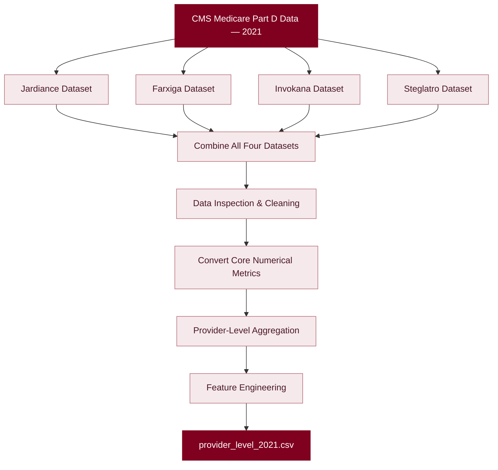

# ✦ DAY 02 — DATA INTEGRATION & FEATURE ENGINEERING

<p align="center">
  
  
  
</p>

<p align="center">
  <em>From raw prescription records to structured, provider-level features.</em>
</p>

---

## ◈ 01. Overview

The second phase focused on expanding the initial Jardiance dataset by incorporating competitor drug data, performing data preprocessing, and engineering provider-level features.

The objective was to transform individual drug-level prescription records into a unified dataset containing one row per healthcare provider (HCP).

| Project Detail | Description |
|:---|:---|
| Data Source | CMS Medicare Part D Prescribers |
| Reporting Year | 2021 |
| Data Access | Official CMS Data API |
| Primary Identifier | National Provider Identifier (NPI) |
| Final Output | `provider_level_2021.csv` |

---

## ◈ 02. Data Collection

**Four SGLT2 inhibitor brands were included in the analysis.**

| Drug Brand | Records Retrieved |
|:---|---:|
| Jardiance | 87,157 |
| Farxiga | 38,921 |
| Invokana | 12,880 |
| Steglatro | 634 |
| **TOTAL** | **139,592** |

<details>
<summary>⌁ Data collection methodology</summary>

- Retrieved prescription records through the official CMS Data API.
- Applied brand-specific filters for each drug.
- Used pagination to retrieve records in batches.
- Combined all four datasets into a unified DataFrame.

</details>

---

## ◈ 03. Dataset Integration

The individual datasets were concatenated into a single dataset to enable cross-drug prescription analysis.

<p align="center">
  
  
</p>

| Dataset Metric | Result |
|:---|---:|
| Total Records | 139,592 |
| Unique Providers | 101,500 |
| Total Columns | 22 |
| Duplicate Records | 0 |

**Provider identification:** `Prscrbr_NPI`

The NPI field was retained as the unique identifier for each healthcare provider.

---

## ◈ 04. Data Inspection & Preprocessing

The combined dataset was inspected to understand its structure, data types and missing-value patterns.

**Key observations:**

- The dataset contained 22 columns.
- All columns were initially stored as `object` data types.
- Empty values were observed in beneficiary-related and age-specific fields.
- No unexpected non-numeric values were found in the selected core numerical metrics.

### Numerical Feature Conversion

Four core prescription metrics were converted into appropriate numerical data types.

| Feature | Description |
|:---|:---|
| `Tot_Clms` | Total prescription claims |
| `Tot_30day_Fills` | Total 30-day fills |
| `Tot_Day_Suply` | Total day supply |
| `Tot_Drug_Cst` | Total drug cost |

**Validation result**

| Core Metric | Missing Values |
|:---|---:|
| `Tot_Clms` | 0 |
| `Tot_30day_Fills` | 0 |
| `Tot_Day_Suply` | 0 |
| `Tot_Drug_Cst` | 0 |

Beneficiary-related and age-specific fields were excluded from the initial aggregation. Their missing values were not blindly replaced with zero.

---

## ◈ 05. Provider-Level Feature Engineering

<blockquote>
  <strong>The key transformation of Day 02.</strong>

  Multiple drug-level records belonging to the same provider were transformed into a single provider-level record.
</blockquote>

A pivot-table transformation was applied using the following configuration:

| Parameter | Configuration |
|:---|:---|
| Index | `Prscrbr_NPI` |
| Columns | `Brnd_Name` |
| Values | Four core prescription metrics |
| Aggregation | Sum |
| Missing drug-metric combinations | Filled with 0 |

### Engineered Feature Structure

Each provider received four prescription metrics for each of the four drug brands.

| Drug | Generated Features |
|:---|:---|
| Jardiance | Claims, Fills, Day Supply, Cost |
| Farxiga | Claims, Fills, Day Supply, Cost |
| Invokana | Claims, Fills, Day Supply, Cost |
| Steglatro | Claims, Fills, Day Supply, Cost |

**Example feature names:**

```text
Jardiance_Tot_Clms
Jardiance_Tot_30day_Fills
Jardiance_Tot_Day_Suply
Jardiance_Tot_Drug_Cst

Farxiga_Tot_Clms
Invokana_Tot_Clms
Steglatro_Tot_Clms
```

The resulting multi-level column names were flattened to create a clean and model-friendly structure.

---

## ◈ 06. Transformation Workflow



---

## ◈ 07. Final Dataset & Validation

<sub>FINAL OUTPUT · 2021 PROVIDER-LEVEL DATASET</sub>

| Validation Metric | Final Result |
|:---|---:|
| Total Providers | **101,500** |
| Total Columns | **17** |
| Missing Values | **0** |
| Duplicate Rows | **0** |
| Duplicate NPIs | **0** |

<p align="center">
  
  
  
  
</p>

**Exported dataset:** `provider_level_2021.csv`

The final dataset was successfully validated, saved and downloaded for the next modelling stage.

---

## ◈ 08. Key Achievements

- [x] Retrieved three competitor drug datasets through the CMS API.
- [x] Integrated four SGLT2 inhibitor datasets.
- [x] Inspected data types and missing-value patterns.
- [x] Converted core numerical prescription metrics.
- [x] Aggregated drug-level records by provider.
- [x] Engineered 16 drug-specific numerical features.
- [x] Validated provider uniqueness and dataset quality.
- [x] Exported the final provider-level dataset.

---

## ◈ 09. What's Next?

### DAY 03 — TARGET VARIABLE CONSTRUCTION

The next phase focuses on retrieving the corresponding 2022 prescription data and constructing the target variable for supervised machine learning.

**Planned direction:**

| Component | Data |
|:---|:---|
| Input Features (X) | 2021 provider-level prescription features |
| Prediction Year | 2022 |
| Target Variable (y) | High Jardiance Prescriber Classification |

The objective is to identify healthcare providers who are likely to become high Jardiance prescribers based on their historical prescription patterns.

---

<p align="center">
  <strong>DAY 02 · COMPLETED</strong>
  <br/>
  <em>Building the foundation for predictive HCP targeting.</em>
  <br/><br/>
  
</p>
